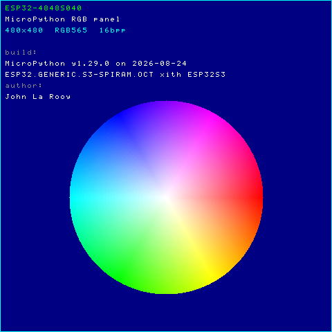
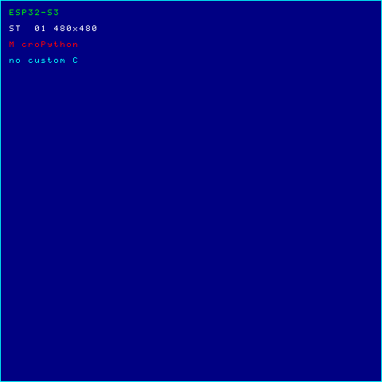
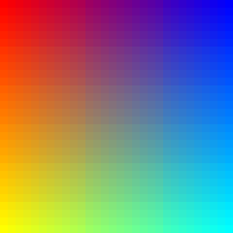
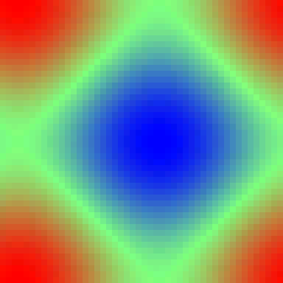
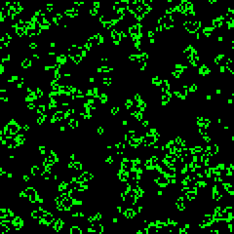
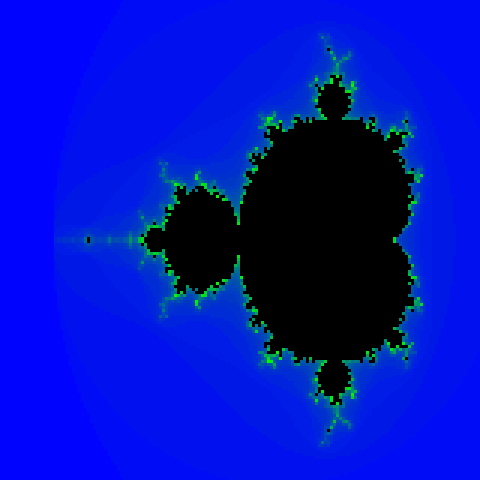
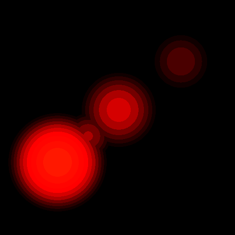

# Pure-MicroPython RGB LCD driver for the Guition ESP32-S3-4848S040

A 480x480 IPS panel driver that runs on **stock MicroPython** - no custom C
module, no custom firmware build. The ESP32-S3's `LCD_CAM` peripheral, its
`GDMA` channel, the GPIO matrix routing and the PSRAM cache flush are all
programmed directly from Python through `machine.mem32`.

It is a register-for-register port of a working custom C module
([`lcd_binding_micropython`](https://github.com/lbuque/lcd_binding_micropython)),
which itself replicates the vendor Arduino demo
`86switch_onoff.ino`. Every value written here was diffed against a register
dump taken from that working reference; see
[`docs/register_map.md`](docs/register_map.md) for the raw dump. Where each
piece came from, and the licenses involved: [Sec. 18](#18-license-and-credits).

On top of the driver sit a set of examples, also pure MicroPython
([Sec. 4](#4-quick-start)): colour bars (`examples/demo.py`), an animated plasma,
a starfield, Conway's Game of Life, the Mandelbrot set, and viper-compiled
versions of the plasma, the Mandelbrot set and a lava lamp.  They are
standalone "driver-only" programs (`examples/`); they use only
``esp32_4848s040.py`` and MicroPython's built-in modules.

---

## Table of contents

- [1. TL;DR](#1-tldr)
- [2. Hardware](#2-hardware)
- [3. Required firmware](#3-required-firmware)
- [4. Quick start](#4-quick-start)
  - [Running the examples](#running-the-examples)
- [5. API](#5-api)
- [6. How the ESP32-S3 drives the panel](#6-how-the-esp32-s3-drives-the-panel)
  - [6.1 The path from a pixel to a pin](#61-the-path-from-a-pixel-to-a-pin)
  - [6.2 Bus clocks and resets](#62-bus-clocks-and-resets)
  - [6.3 The `LCD_CAM` register map](#63-the-lcd_cam-register-map)
  - [6.4 The GPIO matrix](#64-the-gpio-matrix)
  - [6.5 The clock tree](#65-the-clock-tree)
  - [6.6 RGB timing](#66-rgb-timing)
  - [6.7 `LCD_USER` and `LCD_MISC`](#67-lcd_user-and-lcd_misc)
  - [6.8 Register summary](#68-register-summary)
  - [6.9 Start sequence](#69-start-sequence)
- [7. The GDMA engine and descriptors](#7-the-gdma-engine-and-descriptors)
  - [7.1 Descriptor format](#71-descriptor-format)
  - [7.2 Why the descriptors must be in internal DRAM](#72-why-the-descriptors-must-be-in-internal-dram)
- [8. Flushing the PSRAM framebuffer](#8-flushing-the-psram-framebuffer)
- [9. Double buffering](#9-double-buffering)
  - [9.1 Two framebuffers, two descriptor lists](#91-two-framebuffers-two-descriptor-lists)
  - [9.2 The swap is one 32-bit store](#92-the-swap-is-one-32-bit-store)
  - [9.3 It lands at the next frame boundary](#93-it-lands-at-the-next-frame-boundary)
  - [9.4 Levels of buffering, and what it costs](#94-levels-of-buffering-and-what-it-costs)
- [10. The ST7701 controller](#10-the-st7701-controller)
  - [10.1 3-wire 9-bit SPI](#101-3-wire-9-bit-spi)
  - [10.2 Command set and bank switching](#102-the-command-set-and-bank-switching)
  - [10.3 The init sequence, piece by piece](#103-the-init-sequence-piece-by-piece)
  - [10.4 The RGB interface](#104-the-rgb-interface)
- [11. How the framebuffer maps to the display](#11-how-the-framebuffer-maps-to-the-display)
  - [11.1 Framebuffer geometry](#111-framebuffer-geometry)
  - [11.2 Pixel bit layout](#112-pixel-bit-layout)
  - [11.3 From a bit to a physical pin](#113-from-a-bit-to-a-physical-pin)
  - [11.4 Why no byte swapping is needed](#114-why-no-byte-swapping-is-needed)
  - [11.5 Orientation](#115-orientation)
- [12. Verification](#12-verification)
- [13. Performance](#13-performance)
- [14. Design notes and deviations from ESP-IDF](#14-design-notes-and-deviations-from-esp-idf)
  - [14.1 Known limitations](#141-known-limitations)
- [15. File layout](#15-file-layout)
- [16. Troubleshooting](#16-troubleshooting)
- [17. Further reading](#17-further-reading)
- [18. License and credits](#18-license-and-credits)

---

## 1. TL;DR

```python
from esp32_4848s040 import DPI

d = DPI()                       # ~1.7 s: panel init + DMA setup
d.test_pattern()                # 8 vertical colour bars
d.show()                        # flush the framebuffer to PSRAM (fast, ~1 ms)

import framebuf
fb = d.fbuf                     # a framebuf.FrameBuffer over the panel memory
fb.text("hello", 8, 8, 0xFFFF)
fb.rect(0, 0, 480, 480, 0x07FF)
d.show()
```

For animation, `DPI(fbs=2)` double buffers and the same code stops tearing -
[Sec. 9](#9-double-buffering).

A few examples build on this, all pure MicroPython ([Sec. 4](#4-quick-start)):
colour bars (`examples/demo.py`), an animated plasma, a starfield, Conway's
Game of Life, the Mandelbrot set and a lava lamp, plus viper-compiled
versions of the plasma, the Mandelbrot set and the lava lamp that run tens
to hundreds of times faster.  They use only the driver and built-in
MicroPython modules - perfect for quick experiments.

* **Refresh is autonomous.** Once `DPI()` has started, a circular DMA
  descriptor list keeps feeding the panel forever. The CPU only touches the
  framebuffer and calls `show()` when it wants the new content to appear. The
  CPU is never on the pixel path - and with `fbs=2` the DMA is pointed at the
  new frame by rewriting one pointer in that list ([Sec. 9](#9-double-buffering)).
* **The panel is 16-bit RGB565 in PSRAM.** `d.fb` is a plain 460800-byte
  `bytearray`; pixel `(x, y)` is the little-endian `uint16` at
  `(y * 480 + x) * 2`, with red in bits 15..11, green in 10..5, blue in 4..0.
* **Three non-obvious things** make this work, and they are the reason the
  naive approaches fail:
  1. The ST7701's command interface is **9-bit** SPI (a D/C bit plus 8 data
     bits). ESP-IDF's SPI master cannot emit 9-bit frames, so the panel init is
     **bit-banged** on three plain GPIOs.
  2. The GDMA descriptor list **must live in internal DRAM**, because
     `OUT_LINK` only holds 20 address bits. Stock MicroPython has no API for
     that, so the descriptors are obtained by exhausting the GC heap until it
     grows into internal RAM.
  3. The PSRAM framebuffer must be **explicitly written back** to external RAM
     before the DMA reads it, because the DMA does not snoop the CPU's cache.

---

## 2. Hardware

| item | description |
| --- | --- |
| Board | Guition **ESP32-S3-4848S040** |
| Panel | 480x480 IPS, **ST7701S** controller, 16-bit RGB parallel (DPI - Digital Parallel Interface) |
| MCU | ESP32-S3 (QFN56) revision v0.2, 8 MB embedded octal PSRAM |
| Buttons | **none** - flashing relies on the CH340 auto-bootloader |
| Host port | `/dev/ttyUSB0` (CH340 USB-serial) |

### Pin map

The ESP32-S3 has a GPIO matrix, so every LCD signal can go to almost any pin.
This board's fixed wiring (from the vendor Arduino demo `86switch_onoff.ino`) is:

| LCD signal | ESP32 GPIO | signal index | notes |
| --- | --- | --- | --- |
| `LCD_DATA_OUT0` | 4 | 133 | blue bit 0 |
| `LCD_DATA_OUT1` | 5 | 134 | blue bit 1 |
| `LCD_DATA_OUT2` | 6 | 135 | blue bit 2 |
| `LCD_DATA_OUT3` | 7 | 136 | blue bit 3 |
| `LCD_DATA_OUT4` | 15 | 137 | blue bit 4 |
| `LCD_DATA_OUT5` | 8 | 138 | green bit 0 |
| `LCD_DATA_OUT6` | 20 | 139 | green bit 1 |
| `LCD_DATA_OUT7` | 3 | 140 | green bit 2 |
| `LCD_DATA_OUT8` | 46 | 141 | green bit 3 |
| `LCD_DATA_OUT9` | 9 | 142 | green bit 4 |
| `LCD_DATA_OUT10` | 10 | 143 | green bit 5 |
| `LCD_DATA_OUT11` | 11 | 144 | red bit 0 |
| `LCD_DATA_OUT12` | 12 | 145 | red bit 1 |
| `LCD_DATA_OUT13` | 13 | 146 | red bit 2 |
| `LCD_DATA_OUT14` | 14 | 147 | red bit 3 |
| `LCD_DATA_OUT15` | 0 | 148 | red bit 4 |
| `LCD_H_SYNC` | 16 | 151 | |
| `LCD_V_SYNC` | 17 | 152 | |
| `LCD_H_ENABLE` | 18 | 150 | DE |
| `LCD_PCLK` | 21 | 154 | 11 MHz |
| *(plain GPIO)* | 38 | - | backlight, active high |
| *(plain GPIO)* | 39 | - | ST7701 CS |
| *(plain GPIO)* | 48 | - | ST7701 SCK |
| *(plain GPIO)* | 47 | - | ST7701 SDA |

"signal index" is the peripheral output-signal number in `gpio_sig_map.h`
(`LCD_DATA_OUT0` is 133, and the 16 data lines are contiguous). Note the data
wiring is a permutation, not a straight run: the vendor assigned `data[0..15]`
to `(4, 5, 6, 7, 15, 8, 20, 3, 46, 9, 10, 11, 12, 13, 14, 0)`. That tuple is
literally `DATA_PINS` in the `registers` section of `esp32_4848s040.py`; nothing else depends on the
permutation, because the GPIO matrix does the mapping.

> Pins 39/47/48 are used as ordinary GPIO outputs for the panel's 3-wire
> configuration interface; they are *not* routed through the SPI peripheral
> (see [Sec. 10.1](#101-3-wire-9-bit-spi)).

---

## 3. Required firmware

The driver needs **octal-SPIRAM** stock MicroPython. The framebuffer is
460800 bytes and must live in PSRAM.

| build | PSRAM | works? |
| --- | --- | --- |
| `ESP32_GENERIC_S3-SPIRAM_OCT` v1.29.0 | 8 MB octal, auto-detected | **yes** |
| `ESP32_GENERIC_S3` (plain) | not detected | **no** - only ~250 KB of heap, the framebuffer does not fit |

Verify on the REPL:

```python
>>> import sys; sys.implementation._build
'ESP32_GENERIC_S3-SPIRAM_OCT'
>>> import gc; gc.mem_free()
8318720
```

Download the official v1.29.0 (2026-08-24) `ESP32_GENERIC_S3-SPIRAM_OCT`
image from <https://micropython.org/download/ESP32_GENERIC_S3/> and flash it
with

```sh
esptool --chip esp32s3 --port /dev/ttyUSB0 --baud 460800 erase-flash
esptool --chip esp32s3 --port /dev/ttyUSB0 --baud 460800 \
    write-flash -z --flash-mode dio --flash-freq 80m --flash-size 16MB \
    0x0 ESP32_GENERIC_S3-SPIRAM_OCT-20260824-v1.29.0.bin
```

Boards are often shipped with the *vendor* firmware pre-flashed, which is a
different build: `sys.implementation._build` reads `GUITION_4848S040`, the
version is a `-preview` daily, and the `lcd` C module is frozen in. That build
is what this driver was reverse-engineered from, but it is not what the driver
needs - stock works and is the point of this repo. Check with

```python
>>> import sys; sys.implementation._build
'GUITION_4848S040'          # vendor build: reflash to use this driver on stock
>>> import lcd               # present only on the vendor build
```

`erase-flash` wipes the whole chip, including everything on the board's
filesystem, so copy any files you want to keep off the board first.

---

## 4. Quick start

Flash the board once ([Sec. 3](#3-required-firmware)), then put the driver on it
- it is a single file, and the only file from this repo the examples need:

```sh
mpremote connect /dev/ttyUSB0 cp esp32_4848s040.py :esp32_4848s040.py
```

### Running the examples

Every example in [`examples/`](examples) needs only the driver plus
MicroPython's built-in modules, so once the driver is on the board they run
straight from the host - nothing else has to be copied:

```sh
mpremote connect /dev/ttyUSB0 run examples/<name>.py
```

| example | screenshot | what it shows |
| --- | --- | --- |
| [`hello.py`](examples/hello.py) |  | the smallest complete program: five solid fills, the colour-bar test pattern, then an info frame naming the device, the RGB565 480x480 format, the running MicroPython version banner and the author, over a full hue/saturation colour wheel. **Start here.** |
| [`demo.py`](examples/demo.py) |  | the "does the panel work" demo: solid primaries, the test pattern, and text with a border. The one to copy to `:main.py` for boot. |
| [`gradient.py`](examples/gradient.py) |  | a full-screen 2D colour gradient, drawn as 900 solid 16x16 blocks via `fill_rect` rather than a per-pixel Python loop. |
| [`plasma.py`](examples/plasma.py) |  | an animated plasma evaluated once per 10x10 block, double buffered (~2.7 fps). |
| [`plasma_viper.py`](examples/plasma_viper.py) |  | the same plasma at full 480x480 resolution with the hot loop compiled by `@micropython.viper` (~11 fps). |
| [`starfield.py`](examples/starfield.py) |  | a 3D starfield flying towards the viewer: depth-sorted points projected by dividing by z, double buffered. |
| [`life.py`](examples/life.py) |  | Conway's Game of Life on a 120x120 grid; each generation is drawn whole into the off-screen buffer. |
| [`mandelbrot.py`](examples/mandelbrot.py) |  | the Mandelbrot set in pure Python at coarse resolution - a couple of minutes per frame, the reference the viper version is compared against. |
| [`mandelbrot_viper.py`](examples/mandelbrot_viper.py) |  | the same image at full 480x480 resolution in viper fixed point: **1.4 s vs ~208 s**. |
| [`lavalamp_viper.py`](examples/lavalamp_viper.py) |  | three metaballs on a thermal-convection model, full 480x480 at ~9 fps. |

[`examples/README.md`](examples/README.md) describes each one in detail,
including the trade-offs behind the viper versions. Ctrl-C stops the animated
ones.

Copy an example to the board as `:main.py` and it runs at every boot; the
same file can be driven from the REPL:

```sh
mpremote connect /dev/ttyUSB0 cp examples/demo.py :main.py
mpremote connect /dev/ttyUSB0
```

```python
>>> import demo; demo.demo()
```

`mpremote fs rm :main.py` puts the board back to a bare REPL. Or run a
one-off script without copying it:

```sh
mpremote connect /dev/ttyUSB0 run my_test.py
```

---

## 5. API

| member | description |
| --- | --- |
| `DPI(width=480, height=480, pclk_hz=11_000_000, ...)` | allocate the framebuffers, init the panel, configure `LCD_CAM`/GDMA and start streaming. "DPI" means Digital Parallel Interface - the kind of parallel RGB bus (separate data lines, HSYNC, VSYNC, DE, PCLK) that this panel uses, as distinct from SPI or MIPI DSI. The class does far more than speak DPI, though: it also runs the ST7701 init over bit-banged SPI, builds the GDMA descriptor lists, manages the PSRAM framebuffer, flushes the data cache, and handles double buffering. |
| `d.fb` | the raw `bytearray` framebuffer being drawn into (RGB565, little-endian) |
| `d.fb_addr` | its physical address |
| `d.fbuf` / `d.framebuffer()` | a `framebuf.FrameBuffer` over the buffer being drawn into |
| `d.framebuffers()` | every framebuffer, indexed by frame (for `fbs>1`) |
| `d.fill(color)` | fill the whole screen |
| `d.fill_rect(x, y, w, h, color)` | |
| `d.pixel(x, y, color)` | |
| `d.bitmap(x, y, w, h, data)` | blit raw little-endian RGB565 bytes |
| `d.test_pattern()` | 8 vertical colour bars |
| `d.show()` | flush the buffer just drawn to PSRAM and put it on the panel |
| `d.stop()` | stop the DMA channel and the LCD engine |
| `d.backlight(on=True)` | gate the backlight (GPIO 38) |
| `d.registers()` | snapshot of the `LCD_CAM`/GDMA registers, for diffing |
| `d.num_desc` | number of DMA descriptors per framebuffer |
| `d.fbs` | number of framebuffers (`1`, or `2` for double buffering) |
| `d.refresh_hz` / `d.frame_ms` | refresh rate derived from the programmed clock and timings |

Colours are ordinary RGB565: `0xF800` red, `0x07E0` green, `0x001F` blue,
`0xFFFF` white, `0x0000` black.

Constructor parameters of interest:

| parameter | default | meaning |
| --- | --- | --- |
| `pclk_hz` | 11 000 000 | pixel clock; see [Sec. 6.5](#65-the-clock-tree) |
| `hsync_pulse_width` / `hsync_back_porch` / `hsync_front_porch` | 8 / 50 / 10 | horizontal timing |
| `vsync_pulse_width` / `vsync_back_porch` / `vsync_front_porch` | 8 / 20 / 10 | vertical timing |
| `hsync_idle_low`, `vsync_idle_low`, `de_idle_high` | all `False` | sync polarity at idle |
| `pclk_active_neg`, `pclk_idle_high` | `False` | pixel clock edge / idle level |
| `panel_init` | `True` | run the ST7701 bring-up; `False` to skip it |
| `fbs` | `1` | framebuffers: `2` = double buffering; see [Sec. 9](#9-double-buffering) |
| `idf_interrupts` | `True` | enable the same interrupt masks ESP-IDF does (inert, see [Sec. 14](#14-design-notes-and-deviations-from-esp-idf)) |
| `verbose` | `True` | print progress |

---

## 6. How the ESP32-S3 drives the panel

The ESP32-S3 has a dedicated peripheral for exactly this job, `LCD_CAM`,
which in "RGB mode" acts as a parallel RGB (DPI) transmitter: it reads pixels
from memory through its own DMA and shifts them out as a video timing stream,
with no CPU involvement.

```
        PSRAM                    LCD_CAM peripheral              panel
   +------------+   GDMA   +-----------------------+  GPIO   +-----------+
   | RGB565     | -------> | async FIFO -> 16 data | matrix  | ST7701S   |
   | 460800 B   |  (link   | + HSYNC/VSYNC/DE/PCLK | ------> | + 480x480 |
   | @0x3C000000|   list)  +-----------------------+         +-----------+
   +------------+
   d.fb            113 descriptors          20 pins
```

### 6.1 The path from a pixel to a pin

1. You write RGB565 pixels into `d.fb`, which lives in **PSRAM** at `0x3C...`.
2. `d.show()` writes the dirty cache lines of that range back to PSRAM
   ([Sec. 8](#8-flushing-the-psram-framebuffer)).
3. The **GDMA** channel walks a circular list of 113 descriptors, each copying
   a contiguous chunk (<= 4095 bytes) of the framebuffer into `LCD_CAM`'s async
   TX FIFO ([Sec. 7](#7-the-gdma-engine-and-descriptors)).
4. `LCD_CAM` in **RGB mode** pops 16 bits at a time out of the FIFO
   (`lcd_user.lcd_2byte_en = 1`) and drives `LCD_DATA_OUT[15:0]` in step with
   the generated video timing: `PCLK` toggles once per pixel, `DE` marks the
   active region, `HSYNC`/`VSYNC` mark line and frame boundaries.
5. The **GPIO matrix** maps each of those 20 internal signals onto the pin the
   board actually uses ([Sec. 6.4](#64-the-gpio-matrix)).
6. The ST7701 shifts each pixel into its internal 480x480 frame buffer using
   `PCLK` as its clock, and continuously scans it out to the glass.
7. `lcd_misc.lcd_next_frame_en = 1` tells `LCD_CAM` to keep going forever, and
   the last descriptor points back at the first, so the stream never stops.

### 6.2 Bus clocks and resets

`LCD_CAM` and the general-purpose **GDMA** each have a bus clock that is **off**
at reset on this chip. Until they are enabled, *every* register in both
peripherals reads back as zero. This is the first thing that must happen, and
it lives in `SYSTEM_PERIP_CLK_EN1`:

| register | offset | bit | field | action |
| --- | --- | --- | --- | --- |
| `SYSTEM_PERIP_CLK_EN1` | `0x1C` | 6 | `SYSTEM_DMA_CLK_EN` | set -> enable GDMA bus clock |
| | | 8 | `SYSTEM_LCD_CAM_CLK_EN` | set -> enable `LCD_CAM` bus clock |
| | | 10 | `SYSTEM_USB_DEVICE_CLK_EN` | **left alone** (boot default) |
| `SYSTEM_PERIP_RST_EN1` | 0x24 | 6 | GDMA reset | assert then de-assert |
| | | 8 | `LCD_CAM` reset | assert then de-assert |

Both are read-modify-writes, so unrelated peripherals are untouched. ESP-IDF
does the same thing from `lcd_ll_enable_bus_clock()` and
`gdma_ll_enable_bus_clock()`.

The reset bits are **asserted and then de-asserted**, not merely left clear
(they are already clear on a stock board). Asserting them restores every
`LCD_CAM`/GDMA register to its hardware default, which is what makes the final
register state independent of whatever ran before.

```python
from esp32_4848s040 import lcd_cam, gdma

lcd_cam.enable_bus_clock(True)   # SYSTEM_PERIP_CLK_EN1 |= 1<<8
lcd_cam.reset_peripheral()       # RST_EN1 |= 1<<8, then &= ~(1<<8)
gdma.enable_bus_clock(True)      # SYSTEM_PERIP_CLK_EN1 |= 1<<6
gdma.reset_peripheral()          # RST_EN1 |= 1<<6, then &= ~(1<<6)
```

On a stock board, before the driver runs:

```
PERIP_CLK_EN1 = 0x00000400   # only the USB device clock
PERIP_RST_EN1 = 0x000003CE   # DMA and LCD_CAM already out of reset
```

and after: `PERIP_CLK_EN1 = 0x00000540`, `PERIP_RST_EN1 = 0x0000028E` -
exactly the reference's values.

### 6.3 The `LCD_CAM` register map

| offset | register | what it controls |
| --- | --- | --- |
| `0x00` | `LCD_CLOCK` | clock source, fractional divider, prescaler, polarity |
| `0x04` | `CAM_CTRL` | camera path - **unused** |
| `0x0C` | `CAM_RGB_YUV` | camera colour converter - **unused** |
| `0x10` | `LCD_RGB_YUV` | LCD colour converter - **unused** (RGB, not YUV) |
| `0x14` | `LCD_USER` | transfer phases, data width, byte/bit order, start/reset |
| `0x18` | `LCD_MISC` | async-FIFO threshold, blanking, auto-next-frame |
| `0x1C` | `LCD_CTRL` | horizontal front blank, active/total height, RGB mode |
| `0x20` | `LCD_CTRL1` | vertical front blank, active/total width |
| `0x24` | `LCD_CTRL2` | sync widths, polarity, HSYNC-in-porch, HSYNC position |
| `0x28` | `LCD_CMD_VAL` | SPI command value - **unused** |
| `0x64` | `LC_DMA_INT_ENA` | interrupt enables for the DMA interface |
| `0xFC` | `LCD_REG_DATE` | silicon date, read-only |

### 6.4 The GPIO matrix

Every peripheral output signal on the ESP32-S3 goes through a per-pin mux
register:

```
GPIO_FUNC<n>_OUT_SEL_CFG  @  0x60004554 + 4*n
    bits [9:0]   out_sel     0..0x0FF = peripheral signal, 0x100 = plain GPIO
    bit  10      oen_sel     take output-enable from the peripheral
    bit  11      oen_inv_sel invert that output-enable
```

Writing a raw signal index (always < `0x100`) therefore leaves `oen_sel` and
`oen_inv_sel` at zero, so the pin's output enable comes from the plain
`GPIO_ENABLE`/`GPIO_ENABLE1` registers - which is exactly what the reference
does. the `gpio matrix` section of `esp32_4848s040.py` writes the `_W1TS` aliases (`0x24` for `0..31`,
`0x30` for `32..48`) rather than read-modify-writing the status registers, so
the operation is idempotent and cannot disturb the other pins.

The GPIO matrix is only one of the two muxes in the way, though. Each pad also
has an **IO_MUX** register (`IO_MUX_GPIO0_REG + 4*n` @ `0x60009004`) whose
`MCU_SEL` field (`bits [14:12]`) chooses what actually drives the pad: `1` is
the GPIO function, `0` is the pad's own IOMUX function. The reset value is *not*
`1` on every pin - GPIO39, the panel's chip-select, resets to `0`. Unless
`MCU_SEL` is set to the GPIO function, writes to the GPIO output register never
reach the pad, so `enable_output()` selects it (`MCU_SEL_GPIO | FUN_IE`)
alongside setting the `ENABLE` bit. Getting this wrong is invisible across a
warm reboot: the panel keeps the configuration the Arduino demo wrote, and the
init only fails on a real power cycle.

Result (verified against the reference dump):

| register | address | value | meaning |
| --- | --- | --- | --- |
| `GPIO_ENABLE` | `0x60004020` | `0x0037FFF9` | GPIO 0, 3..18, 20, 21 - the 15 data lines below GPIO 32, plus HSYNC (16), VSYNC (17), DE (18) and PCLK (21) |
| `GPIO_ENABLE1` | `0x6000402C` | `0x0001C0C0` | GPIO 38 (backlight), 39 (CS), 46 (data bit 8), 47 (SDA), 48 (SCK) |
| `GPIO_OUT1` | `0x60004010` | `0x000000C0` | GPIO 38 and 39 high: backlight on, CS idle |
| all other pins | | `0x100` | plain GPIO |

### 6.5 The clock tree

The pixel clock is derived from the 160 MHz `PLL_F160M` through a **fractional
divider** followed by an integer **prescaler**, both in `LCD_CLOCK`:

```
  PCLK = PLL_F160M / (div_num + div_b/div_a) / (clkcnt_n + 1)
       = 160 MHz   / (7       + 3/11      ) / 2
       = 22 MHz    / 2
       = 11 MHz

  LCD_CLOCK = 0xE5860E01
```

| field | bits | value | meaning |
| --- | --- | --- | --- |
| `clkcnt_n` | 5:0 | 1 | prescaler = `clkcnt_n + 1` = 2 |
| `clk_equ_sysclk` | 6 | 0 | 0 = go through the fractional divider (1 would bypass it) |
| `ck_idle_edge` | 7 | 0 | `pclk_idle_high = False` |
| `ck_out_edge` | 8 | 0 | `pclk_active_neg = False` |
| `clkm_div_num` | 16:9 | 7 | integer part |
| `clkm_div_b` | 22:17 | 3 | fractional numerator |
| `clkm_div_a` | 28:23 | 11 | fractional denominator |
| `clk_sel` | 30:29 | 3 | `PLL_F160M` |
| `clk_en` | 31 | 1 | clock on |

`lcd_cam.cal_pclk_div()` in `esp32_4848s040.py` reproduces ESP-IDF's two-step search
(`hal_utils_calc_clk_div_frac_fast()` to approximate `src/prescale` as
`integer + num/den`, then unwind if the fraction will not fit). For
160 MHz -> 11 MHz it returns prescale 2 with `div_num=7, div_a=11, div_b=3`,
which is bit-identical to the reference.

Because the frame is 548 clocks wide and 518 lines tall:

```
refresh = 11 MHz / (548 x 518) ~= 38.8 Hz
```

That is the rate the vendor demo uses. Raising `pclk_hz` raises the frame rate
(the panel tolerates a range of pixel clocks; the DMA and PSRAM bandwidth are
the practical ceiling).

### 6.6 RGB timing

`LCD_CAM` generates the video timing itself. The counters are **inclusive**, so
`lcd_ll_set_horizontal_timing()` / `lcd_ll_set_vertical_timing()` store
everything "minus one":

| quantity | register / bits | formula | value |
| --- | --- | --- | --- |
| `hb_front` | `LCD_CTRL` 10:0 | `hbp + hsw - 1` = 50 + 8 - 1 | 57 |
| `va_height` | `LCD_CTRL` 20:11 | `height - 1` | 479 |
| `vt_height` | `LCD_CTRL` 30:21 | `vsw+vbp+height+vfp-1` | 517 |
| `rgb_mode_en` | `LCD_CTRL` 31 | RGB (not camera) mode | 1 |
| `vb_front` | `LCD_CTRL1` 7:0 | `vbp + vsw - 1` = 20 + 8 - 1 | 27 |
| `ha_width` | `LCD_CTRL1` 19:8 | `width - 1` | 479 |
| `ht_width` | `LCD_CTRL1` 31:20 | `hsw+hbp+width+hfp-1` | 547 |
| `vsync_width` | `LCD_CTRL2` 6:0 | `vsw - 1` | 7 |
| `vsync_idle_pol` | `LCD_CTRL2` 7 | idle level, from `vsync_idle_low` | 1 (idle high) |
| `de_idle_pol` | `LCD_CTRL2` 8 | idle level, from `de_idle_high` | 0 |
| `hs_blank_en` | `LCD_CTRL2` 9 | keep emitting HSYNC in the porch region | 1 |
| `hsync_width` | `LCD_CTRL2` 22:16 | `hsw - 1` | 7 |
| `hsync_idle_pol` | `LCD_CTRL2` 23 | idle level, from `hsync_idle_low` | 1 (idle high) |
| `hsync_position` | `LCD_CTRL2` 31:24 | HSYNC offset within the line | 0 |

With `hsw=8, hbp=50, hfp=10, vsw=8, vbp=20, vfp=10` this produces
`LCD_CTRL = 0xC0AEF839`, `LCD_CTRL1 = 0x2231DF1B`, `LCD_CTRL2 = 0x00870287`.

Watch out for the field names here: `hb_front`/`vb_front` are the porch **plus
the sync pulse**, not the front porch on its own. The names and the "minus one"
are IDF's; the values above are the ones that come out.

The polarity defaults (`hsync_idle_low=False`, `vsync_idle_low=False`,
`de_idle_high=False`, `pclk_active_neg=False`) come from the reference's
`esp_lcd_rgb_panel_config_t`. They have to match what the panel expects: get
them wrong and the image is blank or torn.

### 6.7 `LCD_USER` and `LCD_MISC`

These two registers describe *how* data leaves the peripheral, as opposed to
*when*.

`LCD_USER` - `0x09802000` while running:

| field | bits | value | meaning |
| --- | --- | --- | --- |
| `lcd_dout_cyclelen` | 12:0 | 0 | data-phase length; unused because... |
| `lcd_always_out_en` | 13 | 1 | ...the data phase runs for as long as the DMA has data |
| `lcd_8bits_order` | 19 | 0 | no byte swap (8-bit-mode feature) |
| `lcd_update` | 20 | 0 | write-only "latch registers" strobe, self-clearing |
| `lcd_bit_order` | 21 | 0 | no bit reversal |
| `lcd_byte_order` | 22 | 0 | no byte reversal |
| `lcd_2byte_en` | 23 | 1 | **16 bits per step** - one pixel per read |
| `lcd_dout` | 24 | 1 | enable the data phase |
| `lcd_dummy` | 25 | 0 | no dummy phase |
| `lcd_cmd` | 26 | 0 | no command phase |
| `lcd_start` | 27 | 1 | transfer running (self-clears when stopped) |
| `lcd_reset` | 28 | 0 | write-only soft reset |

`always_out_en` is the key: with it set, the number of data cycles no longer
comes from `lcd_dout_cyclelen` but "the DMA has content to send", which is what
lets one descriptor list stream an unbounded number of frames.

`LCD_MISC` - `0x06000016`:

| field | bits | value | meaning |
| --- | --- | --- | --- |
| `lcd_afifo_threshold_num` | 5:1 | 11 | async-TX-FIFO "full" threshold (hardware default 17; the reference uses 11) |
| `lcd_vfk_cyclelen` | 11:6 | 0 | non-RGB-mode setup cycles |
| `lcd_vbk_cyclelen` | 24:12 | 0 | non-RGB-mode hold cycles |
| `lcd_next_frame_en` | 25 | 1 | **keep sending frames** instead of stopping after one |
| `lcd_bk_en` | 26 | 1 | generate blank regions |
| `lcd_afifo_reset` | 27 | 0 | write-only FIFO reset, strobed at start |

### 6.8 Register summary

Ground truth is the dump from the working C module
([`docs/dump_working_c.md`](docs/dump_working_c.md)). "replayed" is what this
driver writes.

| address | register | ground truth | replayed |
| --- | --- | --- | --- |
| `0x600C001C` | `SYSTEM_PERIP_CLK_EN1` | `0x00000540` | `0x00000540` |
| `0x600C0024` | `SYSTEM_PERIP_RST_EN1` | `0x0000028E` | `0x0000028E` |
| `0x60041000` | `LCD_CLOCK` | `0xE5860E01` | `0xE5860E01` |
| `0x60041004` | `CAM_CTRL` | `0x00000800` | identical |
| `0x6004100C` | `CAM_RGB_YUV` | `0x00C00000` | identical |
| `0x60041010` | `LCD_RGB_YUV` | `0x00C00000` | identical |
| `0x60041014` | `LCD_USER` | `0x09802000` | identical |
| `0x60041018` | `LCD_MISC` | `0x06000016` | identical |
| `0x6004101C` | `LCD_CTRL` | `0xC0AEF839` | identical |
| `0x60041020` | `LCD_CTRL1` | `0x2231DF1B` | identical |
| `0x60041024` | `LCD_CTRL2` | `0x00870287` | identical |
| `0x60041064` | `LC_DMA_INT_ENA` | `0x00000001` | identical |
| `0x6003F060` | GDMA `OUT_CONF0` | `0x00000030` | identical |
| `0x6003F064` | GDMA `OUT_CONF1` | `0x00004000` | identical |
| `0x6003F070` | GDMA `OUT_INT_ENA` | `0x00000002` | identical |
| `0x6003F0A8` | GDMA `OUT_PERI_SEL` | `0x00000005` | identical |
| `0x6003F080` | GDMA `OUT_LINK` | `0x000AEBF8` | `0x000BA0A0` [1] |

[1] Only the **descriptor arena address** differs, and only because it is placed
wherever the internal-DRAM allocation happens to land. What matters is that
`OUT_LINK & 0xFFFFF == desc_addr & 0xFFFFF`, which holds.

`CAM_CTRL`, `CAM_RGB_YUV` and `LCD_RGB_YUV` belong to the camera path and the
YUV colour converter, neither of which is used for an RGB panel. They are
written with the reference's values purely so that a register diff comes back
clean. (For the record, `CAM_CTRL = 0x00000800` puts 4 in
`cam_clkm_div_num`, bits 16:9 - a side effect of the reference's clock setup
that is reproduced only to keep the dump identical.)

### 6.9 Start sequence

`DPI.start()` in `esp32_4848s040.py` mirrors
`esp_lcd_panel_rgb.c::lcd_rgb_panel_start_transmission()`:

```
dma.reset()           # pulse out_rst: clears channel state and the FIFO
lcd_cam.stop()        # clear lcd_start, strobe lcd_update
lcd_cam.reset()       # LCD_USER.lcd_reset = 1  (write-only)
lcd_cam.fifo_reset()  # LCD_MISC.lcd_afifo_reset = 1 (self-clearing)
dma.start(desc_addr)  # OUT_LINK = (desc_addr & 0xFFFFF) | (1 << 21)
delay 10 us
lcd_cam.start()       # LCD_USER.lcd_update | lcd_start = 1
```

The order matters. The DMA has to be running **before** the LCD engine starts,
otherwise the async FIFO underflows on the very first line and the panel latches
garbage.

---

## 7. The GDMA engine and descriptors

The GDMA channel's only job is to refill `LCD_CAM`'s FIFO from the framebuffer,
via a **link-list of descriptors**.

| register | offset | value | meaning |
| --- | --- | --- | --- |
| `OUT_CONF0` | `0x60` | `0x30` | `outdscr_burst_en` and `out_data_burst_en` (bits 4 and 5) - burst reads for both descriptors and data |
| `OUT_CONF1` | `0x64` | `0x4000` | `out_ext_mem_bk_size` = 2, i.e. a **64-byte** external-SRAM block size (`gdma_ll_tx_set_burst_size(..., 64)`) |
| `OUT_INT_ENA` | `0x70` | `0x00000002` | `out_eof` = `GDMA_LL_EVENT_TX_EOF` (inert, [Sec. 14](#14-design-notes-and-deviations-from-esp-idf)) |
| `OUT_PERI_SEL` | `0xA8` | 5 | handshake with `LCD_CAM` - peripheral slot 5 |
| `OUT_LINK` | `0x80` | see below | first descriptor address + start bit |

`OUT_LINK` is `addr[19:0] | stop[20] | start[21] | restart[22]`, so the driver
writes `(desc_addr & 0xFFFFF) | (1 << 21)`. The `start` bit clears itself once
the channel is running, which is why a dump taken afterwards shows
`0x000BA0A0` and not `0x002BA0A0`.

The channel is **shared with the WiFi driver**, and *associating* takes it: on
connect, `OUT_PERI_SEL` is reprogrammed (`5` -> `6`) and `out_state` freezes, so
a panel that is already streaming stops dead.  Turning the station on
(`active(True)`) and scanning do *not* disturb it - measured, `OUT_PERI_SEL`
stays `5` and `out_state` keeps advancing through both - so the rule is
narrower than it first looked: **the panel must not be streaming when WiFi
associates**.  In practice, either connect first and build the panel
afterwards, or never connect while the panel is up; either order works as
long as no association happens under a running panel.

### 7.1 Descriptor format

12 bytes per node, little-endian:

| word | bits | field |
| --- | --- | --- |
| `dw0` | 11:0 | `size` - bytes in this buffer (max 4095) |
| | 23:12 | `length` - same value |
| | 30 | `suc_eof` |
| | 31 | `owner` - 1 = owned by the DMA |
| `dw1` | 31:0 | `buffer` - **full 32-bit** address of the framebuffer chunk |
| `dw2` | 31:0 | `next` - **full 32-bit** address of the next node |

A 460800-byte framebuffer is split into the largest chunks the hardware
supports, 4095 bytes:

```
112 x 4095 + 2160 = 460800 bytes   ->   113 descriptors   ->   1356 bytes
```

The last node has `suc_eof = 1` and its `next` points back to the first node, so
the list is **circular** and the panel refreshes forever. First and last nodes
from the reference dump:

```
desc[0]    dw0=0x80FFFFFF  size=4095  owner=1  suc_eof=0
desc[112]  dw0=0xC0870870  size=2160  owner=1  suc_eof=1   next -> desc[0]
```

That self-reference is also the hook double buffering hangs off: a list per
framebuffer, each closed on itself, and a swap is one store into the last
node's `next` ([Sec. 9](#9-double-buffering)).

### 7.2 Why the descriptors must be in internal DRAM

`OUT_LINK` is only 20 bits wide. The hardware comment is explicit:

> `addr` - *This register stores the 20 least significant bits of the first
> outlink descriptor's address.*

so it reconstructs the address as `0x3FC00000 | addr[19:0]`. PSRAM lives at
`0x3C000000`, which that register simply cannot express. The descriptor list
therefore has to sit in internal DRAM.

Stock MicroPython offers no way to ask for internal RAM: the GC's split heap is
grown with `malloc()`, and IDF satisfies that from PSRAM while PSRAM has room.
the `internal_ram` section of `esp32_4848s040.py` obtains an internal buffer by **exhausting the heap**:

1. Allocate 1 MiB fillers in a loop until allocation starts failing. PSRAM is
   now full.
2. Retry with smaller chunks. `gc_try_add_heap()` now sizes its next heap area
   from the largest free block - small - and `malloc()` falls back to
   **internal DRAM** for it.
3. Check each candidate's address with `uctypes.addressof()`; the first one in
   `0x3FC00000..0x3FCFFFFF` is the arena. If none lands there, raise rather
   than silently using PSRAM.
4. Drop the fillers and `gc.collect()`; the arena is kept alive as an ordinary
   object (`d._desc`), so the GC can never hand its memory out again. It is
   also never moved, because MicroPython's GC is non-moving.

```python
need = gdma.descriptor_bytes(460800)        # 113 * 12 = 1356
desc_buf, fillers = internal_ram.grab(need) # lands at e.g. 0x3FCBA0A0
internal_ram.release(fillers)
```

Two ordering details:

* The **framebuffer is allocated first**. The trick above deliberately exhausts
  PSRAM, and a contiguous 450 KB run is not something you want to go looking for
  afterwards.
* `grab()` returns its scaffolding separately so the caller can free it
  immediately; keeping the fillers alive would pin most of the heap.

The arena comes back at 64 KiB even though only 1356 bytes are used, because
MicroPython rounds a fresh heap area up to its minimum size. That is ~64 KiB of
scarce internal DRAM for a 1.3 KB table. If you ever need that memory back for
something else, note that only the **first** descriptor's address is truncated -
later nodes are reached through `dw2`, which is a full pointer - so a 12-byte
stub in internal DRAM plus the remaining 112 descriptors in PSRAM would work.

With `fbs=2` there are two such tables, laid out one after the other in the same
arena ([Sec. 9.1](#91-two-framebuffers-two-descriptor-lists)), so the request is
`fbs * 1356` bytes. The 64 KiB arena already covers that many times over, so the
heap-exhaustion dance is unchanged.

---

## 8. Flushing the PSRAM framebuffer

The DMA reads PSRAM directly and does **not** snoop the CPU's L1 data cache. Any
pixel you just wrote may still be sitting in cache, invisible to the DMA. So
`show()` performs a cache write-back first, exactly as ESP-IDF's
`esp_cache_msync(..., DIR_C2M | UNALIGNED)` does:

| register | offset | meaning |
| --- | --- | --- |
| `EXTMEM_DCACHE_SYNC_CTRL` | `0x28` | bit 0 invalidate, bit 1 **writeback**, bit 2 clean, bit 3 `done` (read-only) |
| `EXTMEM_DCACHE_SYNC_ADDR` | `0x2C` | start address |
| `EXTMEM_DCACHE_SYNC_SIZE` | `0x30` | length in 32-byte **cache blocks** (23-bit) |

```python
DCACHE_SYNC_ADDR = fb_addr & ~31
DCACHE_SYNC_SIZE = ceil(460800 / 32) = 14400 blocks
DCACHE_SYNC_CTRL = 0b0010                    # kick off the write-back
# poll until the writeback bit clears
```

The registers are asynchronous: writing an operation bit starts the operation
and hardware clears the bit when it is done, so `show()` polls.

The **cache block size is 32 bytes** on this part. That is not in the TRM; it
was measured by invalidating a single block at increasing offsets and watching
for the dirty line containing a known address to stop being hit.

In practice the flush costs about 1 ms for a full screen, and the panel often
appears to update correctly even without it, because the DMA is slower than the
cache's eviction rate. It is not guaranteed, so `show()` always does it.

---

## 9. Double buffering

So far there is one framebuffer, and one framebuffer cannot avoid tearing:
`show()` gives the DMA no way to know that a frame is only half-drawn, so it
mixes old and new pixels wherever it happens to be, and the join shows up as a
horizontal discontinuity that sweeps down the panel, once per frame you touch.
On an animation it is impossible to miss; on a static page it never shows.

Double buffering fixes it by drawing somewhere the DMA is not looking:

```python
from esp32_4848s040 import DPI

d = DPI(fbs=2)              # two framebuffers, two descriptor lists
while True:
    d.fill(0x001F)          # goes into the buffer that is off screen
    d.show()                # ... and this puts it on screen whole
```

`fbs` is the number of framebuffers (`1` by default). `show()` flushes and
presents the buffer you drew into, then drawing moves to the next one.
`d.fb`, `d.fb_addr`, `d.fbuf` and `d.framebuffer()` all follow the drawing
target, so the same drawing code works with one framebuffer or two - with
`fbs=1` they simply never move. The double-buffered examples in
[`examples/`](examples) - `plasma.py`, `starfield.py`, `life.py` - run this
way.

### 9.1 Two framebuffers, two descriptor lists

`fbs=2` allocates a second 460800-byte PSRAM framebuffer and builds a second
113-node descriptor list for it, immediately after the first in the same
internal-DRAM arena ([Sec. 7.2](#72-why-the-descriptors-must-be-in-internal-dram)).
Each list is a complete ring on its own - the last node still carries
`suc_eof`, its `next` still points at its own head - so either list alone
would keep repeating its frame forever.

```
     internal DRAM                       PSRAM
  +-------------------+          +-------------------+
  | list 0   (113)    |--------->| framebuffer 0     |  460800 B
  |   tail next -> 0  |          |   0x3C......      |
  +-------------------+          +-------------------+
  | list 1   (113)    |--------->| framebuffer 1     |  460800 B
  |   tail next -> 1  |          |   0x3C......      |
  +-------------------+          +-------------------+
```

Both lists come out of the *one* 64 KiB internal-DRAM arena the driver already
reserves, and the arena is obtained before either list exists, so nothing about
the heap-exhaustion trick changes.

### 9.2 The swap is one 32-bit store

There is no register that retargets the DMA at a different framebuffer.
`LCD_USER.lcd_update` re-reads the timing and configuration registers,
`LCD_MISC.lcd_next_frame_en` only starts and stops the stream as a whole, and
stopping it desynchronises the ST7701. The only lever is the descriptor list,
and the only place the DMA can be redirected is a `next` pointer - so that is
where the swap lives: the tail of each list is pointed at the head of the list
being presented.

```
   before show(1)                            after show(1)
   list 0: ... tail -> head0   (self)        list 0: ... tail -> head1
   list 1: ... tail -> head1   (self)        list 1: ... tail -> head1  (self)
```

Every list is rewritten, not just the one believed to be in flight, so it does
not matter which list the DMA is actually inside: whichever one it finishes, it
lands on the new frame, and the new list's own tail closes the ring. This is
exactly what ESP-IDF does - `gdma_link_concat(fb[i], -1, fb[cur], 0)` for every
`i`, from `rgb_panel_draw_bitmap()`.

Three properties make it safe:

* **It is atomic.** `next` is a full 32-bit pointer at byte offset 8 of a
  12-byte descriptor, and the arena is 4-byte aligned, so each store is one
  aligned word write. The DMA is mid-frame and can never see it half-written.
* **It needs no cache maintenance.** The descriptors live in *internal* DRAM,
  which is not behind the data cache, so the DMA sees the new pointer on its
  next descriptor fetch. (The framebuffer, out in PSRAM, is the opposite case -
  see [Sec. 8](#8-flushing-the-psram-framebuffer).)
* **It cannot dead-end.** Every list is a legal ring before and after, so no
  interleaving of the stores can leave the DMA with nowhere to go.

The cache write-back `show()` normally does is unchanged: it still flushes the
one framebuffer just drawn. Passing `addr`/`nbytes` narrows it to a region.

### 9.3 It lands at the next frame boundary

The hand-off is queued, not instantaneous. The DMA finishes the frame it is in
and *then* walks into the new list, so the picture changes exactly on a frame
boundary - atomic at the picture level, which is the whole point. The price is
a window of up to one frame (`d.frame_ms`, 26 ms at 11 MHz and 548x518) during
which the old frame is still being scanned.

That window is also the one thing that can still tear, because the buffer the
DMA is leaving is the buffer drawing moves to next. The driver will not let you
draw into it: `d.fb`, `d.fbuf`, `d.framebuffer()` - and therefore `fill()`,
`fill_rect()` and `pixel()` - wait out the remainder of the window before
handing the buffer over. A loop that draws one frame per refresh, which is the
only loop that makes sense, finds nothing to wait for. `show()` itself never
waits, so the achievable frame rate is unaffected.

`d.refresh_hz` and `d.frame_ms` come from the actual programmed pixel clock and
the timing registers, so they stay correct if you change either.

### 9.4 Levels of buffering, and what it costs

`fbs` accepts any value from 1 up; the guard stays correct for all of them (a
buffer that may be in flight is marked unavailable until the window has
passed). Two is the useful number here. A third 460800-byte framebuffer buys
nothing unless drawing is faster than a frame, and there is no way to know when
a frame actually ended: the vsync interrupt exists in the register map
(`LC_DMA_INT_ENA`) but nothing on this board routes it to a CPU, so there is no
frame callback to build a deeper pipeline on.

| cost | scales with | here |
| --- | --- | --- |
| PSRAM | `fbs` | 460800 bytes per framebuffer (2 uses ~900 KiB of ~8 MiB) |
| internal DRAM | `fbs` | 1356 bytes of descriptors each, inside the arena already reserved |
| construction | `fbs` | ~20 ms for the extra `bytearray`; the extra list is free |
| `show()` | one frame | unchanged - still one framebuffer written back |
| present rate | one frame | at most one frame per refresh (38.8 Hz); a second `show()` inside the same frame just replaces the first, which the DMA had not reached yet |

The things to watch for:

* **Do not cache the drawing buffer.** `d.fbuf`, `d.fb` and `d.framebuffer()`
  return the *next* buffer to draw into, which changes on every `show()`; a
  reference held across a `show()` keeps pointing at the old one. Ask again
  each frame.
* **`d.registers()` cannot tell you which frame is on screen.** `OUT_LINK`
  reads back unchanged - it is the *configured* list head, not the descriptor
  being fetched - and the rest of the channel's state is no more help. The
  switch is one word inside the descriptor lists, so reading a tail's `next` is
  how to see it.
* **The guard is wall-clock, not an interrupt.** It assumes the hand-off
  completes within `frame_ms` of `show()` returning, which holds as long as the
  stream is running. `d.start()` restarts the stream at the last presented
  list's head and clears the guard.

---

## 10. The ST7701 controller

The ST7701S is the panel driver IC: a 480x480 source driver plus a
gate driver, with an on-chip frame buffer, a charge-pump power supply, gamma
networks and a timing controller. It accepts pixels over a **16-bit RGB parallel
bus** (the video path), and it is **configured** over a separate 3-wire serial
interface (the control path). Both are needed.

### 10.1 3-wire 9-bit SPI

The ST7701's 3-wire serial interface is *not* ordinary SPI. Each frame is
**9 bits** - one D/C bit followed by 8 data bits, MSB first:

```
      CS  ----------------------------------------------  low for the transfer
          +---+---+---+---+---+---+---+---+---+
    SDA   |D/C| b7| b6| b5| b4| b3| b2| b1| b0|
          +---+---+---+---+---+---+---+---+---+
           ^   ^   ^   ^   ^   ^   ^   ^   ^
    SCK   one pulse per bit; SDA is sampled on the rising edge
```

* D/C = `0` -> the 8 bits are a **command**.
* D/C = `1` -> the 8 bits are a **data byte** for the preceding command.

This is why the ESP-IDF SPI master is not used: its data phase is a whole number
of bytes, and there is no way to prepend a single bit. Arduino_GFX has the same
problem, which is why it bit-bangs this interface too. the `st7701` section of `esp32_4848s040.py` does the
same on three plain GPIOs (CS=39, SCK=48, SDA=47), driving SDA while SCK is low
and pulsing SCK high:

```python
def write9(self, dc, b):
    self._sda(dc); self._sck_pulse()                  # the D/C bit
    for bit in (0x80, 0x40, 0x20, 0x10, 0x08, 0x04, 0x02, 0x01):
        self._sda(1 if (b & bit) else 0); self._sck_pulse()   # MSB first
```

Cost: 198 nine-bit frames (33 commands + 165 data bytes) = ~1800 SCK pulses, in
the region of 150 ms - trivial next to the two 120 ms recovery waits that
bracket the sequence.

### 10.2 The command set and bank switching

The ST7701 has more registers than fit in one 8-bit command space, so it uses
**banks**. Command `0xFF` switches banks, taking a fixed unlock prefix followed
by the bank byte:

| write | selects |
| --- | --- |
| `FF 77 01 00 00 10` | bank 0 - the user command set (timing, gamma, format) |
| `FF 77 01 00 00 11` | bank 1 - power, GIP/gate timing |
| `FF 77 01 00 00 13` | bank "0x13" - VAP/VAN (gate voltage levels) |
| `FF 77 01 00 00 00` | back to bank 0 |

Because the panel is configured *before* the video stream starts, and register
writes take effect immediately, this is just a sequence of (bank -> writes)
blocks. Nothing about the RGB data path depends on the bank state.

### 10.3 The init sequence, piece by piece

`st7701.INIT_SEQUENCE` in `esp32_4848s040.py` is 33 commands / 165 data bytes, byte-for-byte
identical to the `OP(...)` list in the working C module - and the C module's
table is in turn Arduino_GFX's
`st7701_type1_init_operations` ([Sec. 18](#18-license-and-credits)). Around it,
`init()` does:

```
CS low -> 0x01 (software reset) -> CS high -> wait 120 ms
CS low -> the whole 33-command table
       -> wait 10 ms -> 0x11 (sleep out) -> CS high -> wait 120 ms
CS low -> 0x29 (display on) -> CS high
CS low -> 0x20 (inversion off) -> CS high
CS low -> 0xFF 77 01 00 00 10          (bank 0)
         0xC7 = 0x00
         0xFF 77 01 00 00 00          (back to the default bank)
         0x36 = 0x00                  (MADCTL) -> CS high
```

The table itself, in order:

**Bank 0 - timing, format and gamma**

| command | value(s) | what it does |
| --- | --- | --- |
| `0xC0` | `3B 00` | line setting (LNESET) - driven-line count and scan direction |
| `0xC1` | `0D 02` | vertical porch control (PORCTRL) - VBP and VFP, in lines |
| `0xC2` | `31 05` | inversion selection - inversion mode and the internal frame-rate divider |
| `0xCD` | `00` | MDT flag (vendor "magic"; the reference annotates it 0x00) |
| `0xB0` | 16 bytes | positive gamma correction |
| `0xB1` | 16 bytes | negative gamma correction |

Gamma tables are per-panel calibrations; they are copied verbatim from
Arduino_GFX's `st7701_type1_init_operations` rather than derived here. The
vendor demo carries no table of its own - its sketches import this same one
from the bundled library - so this is also the table the vendor's demo runs.
Getting them wrong gives banded or washed-out colour, not a blank screen.

**Bank 1 - power supply and gate timing**

| command | value | what it does |
| --- | --- | --- |
| `0xB0` | `60` | Vop - main operating voltage (4.7375 V per the reference) |
| `0xB1` | `32` | VCOM |
| `0xB2` | `07` | VGH - gate high voltage (15 V) |
| `0xB3` | `80` | |
| `0xB5` | `49` | VGL - gate low voltage (-10.17 V) |
| `0xB7` | `85` | |
| `0xB8` | `21` | AVDD / AVCL (6.6 V / -4.6 V) |
| `0xC1`, `0xC2` | `78 78` | source/GIP timing |
| `0xE0`..`0xE8` | 2-16 bytes each | GIP (gate-in-panel) settings: gate clock timing, shift-register behaviour, and the display's own drive waveforms |
| `0xEB` | `02 00 E4 E4 88 00 40` | |
| `0xEC` | `3C 00` | |
| `0xED` | 16 bytes | GIP / drive timing |

These are the internal charge-pump voltages and the row-scan timing. They come
straight from the panel vendor's tuning; the module just replays them.

**Bank 0x13 - VAP/VAN**

| command | value | what it does |
| --- | --- | --- |
| `0xE5` | `E4` | VAP/VAN - the positive/negative source reference levels |

**Back to bank 0 - pixel format**

| command | value | what it does |
| --- | --- | --- |
| `0x3A` | `60` | COLMOD. `0x70` = RGB888, **`0x60` = RGB666**, `0x50` = RGB565 |

### 10.4 The RGB interface

`0x3A = 0x60` selects **RGB666** in the reference: the panel is told to expect
six bits per channel. The board, however, only wires 16 data lines, and the
vendor demo's own pin labels are `R0..R4`, `G0..G5`, `B0..B4` - that is, 5-6-5.
Green gets all six bits; red and blue get five each, and the panel's two
least-significant inputs are simply not driven. What actually reaches the glass
over the RGB bus is therefore 16 bits per pixel, which is why RGB565 is the
natural format here and why a pixel value maps straight to `LCD_DATA_OUT[15:0]`
with no conversion.

Everything else about the video interface is fixed by the wiring and the timing
registers: HSYNC/VSYNC/DE/PCLK polarity and the front/back porches must match
what the panel expects, which is what [Sec. 6.6](#66-rgb-timing) sets up. The panel
only latches pixels while `DE` is high, which is how it distinguishes the
480x480 active area from the blanking intervals.

---

## 11. How the framebuffer maps to the display

This is the part worth getting right, because it is where "the image works but
colours are swapped" bugs come from.

### 11.1 Framebuffer geometry

* Format: **RGB565**, 2 bytes per pixel, little-endian, no padding.
* Size: `480 x 480 x 2 = 460800` bytes.
* Pixel `(x, y)`, with `(0, 0)` at the **top-left**:

```
  byte offset = (y * 480 + x) * 2
  stride      = 480 * 2 = 960 bytes
```

The framebuffer is a plain linear raster: row 0 first, then row 1, and so on,
with no per-row padding and no gap between the last descriptor's chunk and the
next row's start. The 113 DMA descriptors cover it as one unbroken 460800-byte
range, which is why the DMA needs no notion of rows at all - the LCD engine
consumes pixels in order and its own HSYNC/VSYNC counters decide where the row
boundaries are.

### 11.2 Pixel bit layout

Treat the pixel as a `uint16` `v`:

```
  bit  15 14 13 12 11 | 10  9  8  7  6  5 |  4  3  2  1  0
       +---- red -----+ +----- green -----+ +---- blue ----+
            5 bits              6 bits            5 bits

  0xF800  red      0x07E0  green     0x001F  blue     0xFFFF  white
```

In memory (little-endian), byte 0 of a pixel holds bits 7..0 and byte 1 holds
bits 15..8.

### 11.3 From a bit to a physical pin

Each bit of the word drives one `LCD_DATA_OUT` line; the GPIO matrix routes each
line to its pin; the pin is labelled with the panel's channel bit. `LCD_DATA_OUT0`
is the least-significant bit and is the **blue LSB**, so the whole chain lines up
with the standard RGB565 word:

```
  framebuffer bit   LCD_DATA_OUT   GPIO   panel signal
  -----------------------------------------------------
       0..4          OUT0  .. OUT4    4,  5,  6,  7, 15      B0..B4   (blue)
       5..10         OUT5  .. OUT10   8, 20,  3, 46,  9, 10   G0..G5   (green)
      11..15         OUT11 .. OUT15  11, 12, 13, 14,  0       R0..R4   (red)
```

Worked example - pixel `0xF800` (red) at `(0, 0)`:

```
  d.fb[0:2] = 0x00, 0xF8            (little-endian)
  the 16-bit word = 0xF800
  bits 15..11 = 0b11111  -> OUT15..OUT11 = 1 -> GPIO0,14,13,12,11 high  -> R4..R0 = 11111
  bits 10..5  = 0b000000 -> OUT10..OUT5  = 0 -> GPIO10,9,46,3,20,8 low  -> G5..G0 = 000000
  bits  4..0  = 0b00000  -> OUT4..OUT0   = 0 -> GPIO15,7,6,5,4    low  -> B4..B0 = 00000
  -> red = 11111, green = 000000, blue = 00000  -> full-intensity red
```

Blue does the same with `0x001F`, and green with `0x07E0`.

### 11.4 Why no byte swapping is needed

Three `LCD_USER` fields could reorder bytes or bits on the way out
(`lcd_8bits_order`, `lcd_bit_order`, `lcd_byte_order`) and all three are **0**.
And `MicroPython framebuf.RGB565` stores the colour as a native `uint16` - on
this little-endian part, byte 0 = bits 7..0. The two conventions coincide, so a
colour written by `framebuf` lands in the framebuffer in exactly the byte order
the DMA expects, with no conversion layer:

```python
fb = d.fbuf                                  # framebuf.RGB565 over d.fb
fb.fill_rect(0, 0, 240, 480, 0xF800)         # red left half
d.show()
```

This is also why `d.fb` can be handed to any other RGB565 source (a decoded
JPEG, an LVGL render target, a `blit_buffer`) without an intermediate copy.

### 11.5 Orientation

MADCTL (`0x36`) is written as `0x00`, i.e. no mirroring, no row/column
exchange. The panel's native scan order therefore matches the framebuffer's:
`(0, 0)` is the panel's top-left corner, x increases rightwards, y downwards.
If you need a rotation, MADCTL is the right place to do it (it costs nothing,
whereas rotating in software costs a full-frame copy).

---

## 12. Verification

The port was checked against the reference in several independent ways, all
of them before this driver was written down as one file:

* **Register math.** Every register value the driver writes was computed on
  the host against a fake `machine.mem32` and compared, bit for bit, with the
  ground-truth dump taken from the working C module. The dump is kept as
  [`docs/dump_working_c.md`](docs/dump_working_c.md), and the derivations
  are in [`docs/register_map.md`](docs/register_map.md).
* **The ST7701 table.** `st7701.INIT_SEQUENCE` was compared byte for byte
  with the C module's `OP(...)` list ([Sec. 10.3](#103-the-init-sequence-piece-by-piece)).
* **On the device.** A `DPI` was constructed, the registers read back and
  diffed against the same ground truth, and the first and last descriptors of
  each list inspected. With `fbs=2` each list was confirmed to start as a
  self-ring, that `show()` re-points **all** the tails at the frame being
  presented, and that the hand-off lands on a frame boundary.

Visually, `d.test_pattern()` produces eight vertical bars, and they must appear
left-to-right as **red, green, blue, white, yellow, cyan, magenta, black**. Wrong
order or wrong colours points at [Sec. 11](#11-how-the-framebuffer-maps-to-the-display);
noise or tearing points at [Sec. 6.5](#65-the-clock-tree)/[Sec. 6.6](#66-rgb-timing);
a blank screen points at the panel init ([Sec. 10](#10-the-st7701-controller)) or the
DMA ([Sec. 7](#7-the-gdma-engine-and-descriptors)).

---

## 13. Performance

Measured on the board (ESP32-S3 @ 240 MHz, octal PSRAM):

| operation | time |
| --- | --- |
| `DPI()` construction | ~1.7-2.0 s (varies with the internal-DRAM hunt) |
| ... the internal-DRAM hunt ([Sec. 7.2](#72-why-the-descriptors-must-be-in-internal-dram)) | 1.3-1.7 s |
| ... the ST7701 bit-banged init | ~0.4 s, of which **250 ms is deliberate** (the two 120 ms reset / sleep-out recovery waits) |
| ... each framebuffer allocation (460800 bytes in PSRAM) | 20 ms |
| `fill()` (460800 bytes) | 17 ms |
| `fill_rect()` (60x480) | 2 ms |
| `test_pattern()` (8 bars) | 20 ms |
| `show()` (cache write-back) | 0-1 ms |
| `framebuf` fill + text | 16 ms |
| plasma (per-block, double buffered) | ~0.37 s/frame (~2.7 fps) |
| plasma in viper, full 480x480 | ~0.09 s/frame (~11 fps) |
| Mandelbrot in viper, full 480x480 | 1.4 s (the pure-Python coarse version takes ~208 s) |
| lava lamp in viper, full 480x480 | ~0.11 s/frame (~9 fps) |

Three notes:

* Drawing goes through MicroPython's own `framebuf`, which is C. A Python loop,
  or `bytearray` slice assignment, over a PSRAM buffer is roughly a thousand
  times slower for a full screen, because those paths walk elements one at a
  time instead of `memcpy`-ing. Use `d.fbuf`, or bulk `machine.mem32` writes.
* This build's interpreter is slow: a bare `for` loop costs 2.4 us an
  iteration, 3.6 us when it indexes a buffer. `@micropython.viper` compiles the
  loop to machine code and does the same indexed loop in 0.1 us - about 35x
  faster - where `@micropython.native` manages only 1.9 us. A per-point loop in
  Python is therefore hopeless: the pure-Python Mandelbrot example takes ~208 s
  for one frame, against 1.4 s for its viper twin ([Sec. 4](#4-quick-start)).
  `viper` takes only `int`, `uint` and `ptr*` values, so the fixed-point
  versions keep their data biased positive and read it through an unsigned
  pointer (`ptr16`) - see [`examples/README.md`](examples/README.md).
* The `DPI()` construction cost is one-time and is dominated by the deliberate
  PSRAM exhaustion, not by anything on the pixel path.

The panel itself refreshes at `d.refresh_hz` = **38.8 Hz** (`frame_ms` = 26 ms)
with the default 11 MHz pixel clock. That is the ceiling on how fast anything
can appear: a new frame is never shown sooner than the frame boundary after
`show()`, so the fastest useful drawing loop is one frame per refresh.
`show()` itself costs the same with `fbs=2` as with `fbs=1` - the hand-off is
one word write ([Sec. 9](#9-double-buffering)).

---

## 14. Design notes and deviations from ESP-IDF

Everything on the pixel path is bit-identical to the working C module. The
differences below are deliberate and documented.

| item | ESP-IDF / reference | this port | why |
| --- | --- | --- | --- |
| `LC_DMA_INT_ENA` (vsync) | enabled | enabled | ESP-IDF installs an interrupt handler; nothing here routes `LCD_CAM`'s interrupt to a CPU, so the bit is **inert**. Set only so the register diff is clean. |
| GDMA `OUT_INT_ENA` (`out_eof`, "successful EOF") | enabled | enabled | same - `esp_lcd` registers a TX callback, this driver has none. Inert. |
| framebuffer allocation | `heap_caps_malloc(PSRAM)`, optional double buffering | `fbs` plain `bytearray`s | same memory, no allocator |
| double buffering | `num_fbs` + `gdma_link_concat()` re-pointing the lists from `rgb_panel_draw_bitmap()` | `fbs` + `link_to()` re-pointing the lists from `show()` ([Sec. 9](#9-double-buffering)) | the same mechanism, driven from Python |
| frame-complete notification | `on_vsync` / `on_frame_buf_complete` callbacks from the DMA ISR | none | `LCD_CAM`'s interrupt is not routed to a CPU in stock MicroPython, so the one-frame guard is wall-clock ([Sec. 9.3](#93-it-lands-at-the-next-frame-boundary)) |
| cache flush | `esp_cache_msync()` on the region that changed | one full-framebuffer write-back per `show()` | simpler; still correct |
| panel registration | `lcd_com_register_device()` to share `LCD_CAM` between panels | not used | one panel |
| camera / YUV converter registers | left wherever they land | written with the reference's values | keeps a full-register diff clean |
| drawing primitives | n/a | `framebuf` (C) | a Python loop over a PSRAM bytearray is ~1000x slower |
| backlight | driven by the application | `d.backlight()` | convenience |

The implementation also deliberately *does* reproduce two things that are easy
to miss and that IDF handles silently:

* enabling the **`LCD_CAM` and GDMA bus clocks** ([Sec. 6.2](#62-bus-clocks-and-resets)),
* the **cache write-back** on every `show()` ([Sec. 8](#8-flushing-the-psram-framebuffer)).

### 14.1 Known limitations

* `DPI()` can be constructed more than once, but each instance pins ~64 KiB of
  internal DRAM for its descriptor arena. Prefer one instance.
* Only one `pclk_hz` value has been exercised on hardware (11 MHz). The clock
  search handles others, but they are untested.
* Colour conversion (`LCD_RGB_YUV`, `CAM_RGB_YUV`) is untouched, so there is no
  YUV->RGB or RGB->YUV path. It is a full-colour RGB565 driver.
* Touch is not handled. This driver covers only the panel.
* There is no interrupt on frame boundaries, so no `on_vsync` callback and no
  way to know from software exactly when the hand-off happened. Double
  buffering is therefore guarded by a time window rather than an event
  ([Sec. 9.3](#93-it-lands-at-the-next-frame-boundary)).

---

## 15. File layout

```
mpy-esp32-4848s040/
|-- README.md                  <- you are here
|-- LICENSE                    MIT license for this subproject (Sec. 18)
|-- LICENSES/                  upstream license texts (Sec. 18)
|   |-- Arduino_GFX-BSD.txt    upstream license of the borrowed ST7701 table
|   \-- Apache-2.0.txt         license of the ESP-IDF sources this port derives from
|-- esp32_4848s040.py          the single-file driver (DPI, registers, DMA, panel init)
|-- examples/
|   |-- README.md              what each example does, and the viper trade-offs
|   |-- demo.py                demo (solid fills, colour bars, framebuf text)
|   |-- hello.py               smallest complete program (colours, bars, text)
|   |-- gradient.py            full-screen gradient using fill_rect blocks
|   |-- plasma.py              animated double-buffered plasma (per-block)
|   |-- plasma_viper.py        plasma in viper, full 480x480 resolution
|   |-- starfield.py           moving starfield using pixels
|   |-- life.py                Conway's Game of Life, double buffered
|   |-- mandelbrot.py          Mandelbrot set, single frame, rendered in blocks
|   |-- mandelbrot_viper.py    Mandelbrot in viper, fixed point, full 480x480
|   |-- lavalamp_viper.py      metaball lava lamp in viper, full 480x480
|   \-- screenshots/           one PNG per example (the table in Sec. 4)
\-- docs/
    |-- register_map.md        ground truth, bit-field derivations, deviations
    \-- dump_working_c.md      raw register dump from the working C module
```

### Logical sections inside the driver

Even though the driver is one file, it is still organised as the same
logical modules.  Their order matters: the register map is defined first, then
the sections that use it, and ``DPI`` comes last because it pulls everything
together.

```
registers -+- gpio matrix -+- st7701
           |               |
           +- lcd_cam -----+
           +- gdma --------+- DPI
           +- internal_ram +
           +- writeback ---+
```

---

## 16. Troubleshooting

| symptom | likely cause |
| --- | --- |
| `MemoryError: could not obtain N bytes of internal DRAM (is PSRAM enabled?)` | not running the octal-SPIRAM build, so there is no PSRAM to exhaust ([Sec. 3](#3-required-firmware)) |
| panel stays black, registers read back `0` | bus clocks not enabled, or `LCD_CAM` left in reset ([Sec. 6.2](#62-bus-clocks-and-resets)) |
| image is noise, torn, or shifted horizontally | RGB timing or sync polarity ([Sec. 6.6](#66-rgb-timing)) |
| correct shapes, wrong colours | byte/bit order or the RGB565 bit layout ([Sec. 11](#11-how-the-framebuffer-maps-to-the-display)) |
| white screen, no content | ST7701 init did not run, or `0x11`/`0x29` did not follow (display still asleep) |
| previous frame still visible | missing cache write-back - are you calling `show()`? ([Sec. 8](#8-flushing-the-psram-framebuffer)) |
| tearing (a horizontal join that sweeps down) | one framebuffer - use `DPI(fbs=2)` ([Sec. 9](#9-double-buffering)) |
| double buffering still tears | the drawing buffer is being cached across `show()`; ask `d.fbuf` again each frame ([Sec. 9.4](#94-levels-of-buffering-and-what-it-costs)) |
| both framebuffers show the same picture with `fbs=2` | the static parts were only drawn once; draw the whole frame into each buffer, e.g. `for _ in range(d.fbs): draw(d.framebuffer()); d.show()` ([Sec. 9](#9-double-buffering)) |
| `ValueError: descriptor list must be in internal DRAM` | the heap-exhaustion trick failed to land in internal DRAM; check for other large allocations |
| `ValueError: descriptor buffer too small` | the arena is smaller than `fbs * 1356` bytes |
| image updates are very slow | drawing with a Python loop instead of `framebuf` ([Sec. 13](#13-performance)) |
| board does not respond to `mpremote` | an example is `:main.py` and running; hard-reset, or `mpremote fs rm :main.py` ([Sec. 4](#4-quick-start)) |
| blank or dark panel only after a real power cycle (fine on a warm reboot) | the IO_MUX `MCU_SEL` for the panel pins is not selecting the GPIO function; `enable_output()` now sets it ([Sec. 6.4](#64-the-gpio-matrix)) |
| the panel works, then blanks when WiFi associates | an association reprograms GDMA channel 0 and stops the panel's DMA - build the panel after connecting ([Sec. 7](#7-the-gdma-engine-and-descriptors)) |

Register dumps for debugging:

```python
>>> import esp32_4848s040 as lcd
>>> d = lcd.DPI(verbose=False)
>>> for k, v in d.registers().items(): print("%-16s %08x" % (k, v))
```

---

## 17. Further reading

* [`docs/register_map.md`](docs/register_map.md) - the full ground-truth dump,
  every bit-field derivation, and the exact differences from the reference.
* ESP-IDF `esp_lcd` RGB panel driver and `esp_cache_msync` documentation. The
  ESP32-S3 has no public TRM for `LCD_CAM`, so the IDF `lcd_ll.h` /
  `lcd_cam_struct.h` sources are the authoritative bit-field definitions this
  port was derived from.
* ST7701S datasheet - command set, gamma tables and the 3-wire interface
  timing.
* MicroPython `machine.mem32`, `framebuf` and `uctypes` documentation.

---

## 18. License and credits

This subproject's own code is MIT licensed; see [`LICENSE`](LICENSE).
Material it derives from:

* **`lcd_binding_micropython`** (lbuque) -
  <https://github.com/lbuque/lcd_binding_micropython> - the working custom C
  module this driver was ported from register-for-register. It is not
  vendored here; follow the link for its source and MIT license. Its ST7701
  table and register values trace to Arduino_GFX and ESP-IDF (below), which
  is why this port does too.
* **Arduino_GFX** (Moon On Our Nation) - [`esp32_4848s040.py`](esp32_4848s040.py)
  reproduces `st7701_type1_init_operations` from `Arduino_ST7701_RGBPanel.h`
  byte for byte, and the bit-banged 3-wire writer follows
  `Arduino_ESP32RGBPanel`: the 9-bit frames ESP-IDF's SPI master cannot send
  are why Arduino_GFX bit-bangs them, and we do the same
  ([Sec. 10.1](#101-3-wire-9-bit-spi)). Upstream's license text is kept verbatim
  in [`LICENSES/Arduino_GFX-BSD.txt`](LICENSES/Arduino_GFX-BSD.txt) - a
  BSD-style license, Copyright (c) 2012 Adafruit Industries, which
  Arduino_GFX carries from its Adafruit_GFX lineage.
* **The Guition vendor Arduino demo** (`86switch_onoff.ino`) - the board
  wiring and pin assignment ([Sec. 2](#2-hardware)) and the 11 MHz pixel clock
  ([Sec. 6.2](#62-bus-clocks-and-resets)). The vendor
  ships it with the board and attaches no license terms to it; it is used
  here as reference only. Note the vendor's sketches contain no init table
  of their own - they pass Arduino_GFX's table to
  `Arduino_ST7701_RGBPanel` - so the ST7701 table's chain of custody leads
  to Arduino_GFX, not to the vendor
  ([Sec. 10.3](#103-the-init-sequence-piece-by-piece)).
* **ESP-IDF v5.5.5** - every register derivation traces to it (the
  `esp_lcd` RGB panel driver, `lcd_ll.h` and the `soc/*_reg.h` headers).
  Espressif's license is Apache-2.0; the full text is in
  [`LICENSES/Apache-2.0.txt`](LICENSES/Apache-2.0.txt).
